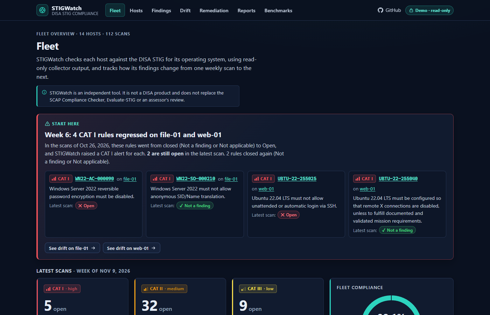
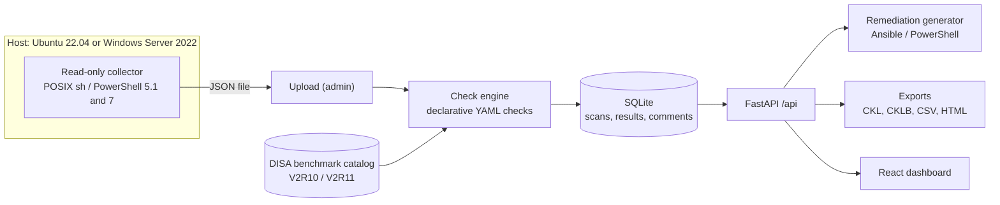

# STIGWatch

A DISA STIG compliance scanner for **Ubuntu 22.04 LTS** (STIG V2R10, 191 rules) and **Windows Server 2022** (STIG V2R11, 277 rules). Read-only collectors gather facts from a host; a declarative check engine turns them into per-rule results; STIGWatch tracks drift between scans by STIG ID, generates remediation you review and run yourself, and exports STIG Viewer checklists (CKL, CKLB) and fleet reports.

**Live demo:** https://stigwatch-demo.vercel.app/. The demo is a fictional fleet of 14 invented hosts with 8 weekly scans each; visitors browse read-only.



> STIGWatch is an independent tool. It is not a DISA product and does not replace the SCAP Compliance Checker, Evaluate-STIG or an assessor's review.

## Why STIG compliance matters for DoD systems

Every statement here comes from DISA's own STIG Overview documents (the Ubuntu 22.04 V2R10 and Windows Server 2022 V2R11 overviews, section numbers below), which are inside the packages DISA publishes at [U_CAN_Ubuntu_22-04_LTS_V2R10_STIG.zip](https://dl.dod.cyber.mil/wp-content/uploads/stigs/zip/U_CAN_Ubuntu_22-04_LTS_V2R10_STIG.zip) and [U_MS_Windows_Server_2022_V2R11_STIG.zip](https://dl.dod.cyber.mil/wp-content/uploads/stigs/zip/U_MS_Windows_Server_2022_V2R11_STIG.zip). Both overviews carry the same text.

- **It is policy, not a suggestion.** Section 1.2 (Authority) quotes DoD Instruction 8500.01 as requiring that all IT that receives, processes, stores, displays or transmits DoD information be configured consistent with applicable DoD cybersecurity policies, standards and architectures, and says DISA develops and maintains the security requirements guides (SRGs) and security technical implementation guides (STIGs) that implement them.
- **Each rule has a severity.** Section 1.3 defines CAT I as a vulnerability whose exploitation will directly and immediately result in loss of confidentiality, availability or integrity; CAT II as one whose exploitation has a potential to result in such a loss; and CAT III as one whose existence degrades the measures that protect against it. STIGWatch tracks CAT I regressions first for that reason.
- **Risk acceptance is the owner's call.** Section 1.7 says the evaluated risks of not applying a setting must be approved by the responsible authorizing official, that settings should be tested in a representative non-production environment first, and that DISA gives no warranty that applying every setting makes a system 100 percent secure. STIGWatch's remediation output carries the same advice.
- **STIGs are public.** Section 1.4 says they are available from the DoD Cyber Exchange (https://cyber.mil/) and, without a CAC, from https://public.cyber.mil/.

The DoDI 8500.01 wording above is as DISA quotes it; the DoD issuance itself and the Cyber Exchange pages refused automated access while this was written, so they are not cited directly. Details: [DECISIONS.md](DECISIONS.md).

## Workflow

1. **Collect.** Run the read-only collector on a host (below). It writes one JSON file and never connects to STIGWatch.
2. **Upload.** An admin uploads the file (dashboard or `POST /api/scans`). The host is matched by the name in the file, or created.
3. **Review.** Findings are grouped by STIG ID across the fleet; each rule shows the facts and evidence behind its status, and assessors can attach comments that persist across scans.
4. **Track drift.** Each scan is compared with the host's previous one by STIG ID. A CAT I rule that goes from closed to Open raises an alert.
5. **Remediate.** Download an Ansible playbook (Ubuntu) or a PowerShell script (Windows) for a host's open findings. STIGWatch only generates them; it never applies anything.
6. **Export.** STIG Viewer checklists (`.ckl`, `.cklb`) per scan, and fleet reports (CSV, HTML).

Statuses are the STIG Viewer ones: Open, Not a Finding, Not Applicable and Not Reviewed. A rule STIGWatch cannot prove either way is Not Reviewed, never a pass.

## Collectors

Both collectors only read. Each fact records the command that produced it, and a fact that cannot be read is recorded as unavailable, so the rules that need it are Not Reviewed rather than guessed.

### Ubuntu 22.04 collector

```sh
sudo sh collectors/collect-linux.sh -o host.json      # -r redacts account names
cd backend
python -m stigwatch collect-parse linux ../host.json  # validate and summarise the facts
python -m stigwatch scan ../host.json                 # per-status counts and Open findings by CAT
python -m stigwatch coverage ubuntu-22.04             # automated and manual rules by CAT
```

The collector is read-only. It writes only the output file and a temporary directory it removes on exit (`gsettings` runs with its runtime and cache directories pointed at that directory and the session bus disabled), and it never outputs password hashes: /etc/shadow and grub.cfg yield counts only. The only digests it reports are the SHA-1 and MD5 checksums of the AIDE cron scripts, which are not secrets. Without root, privileged facts are recorded as unavailable and the rules that need them are reported Not Reviewed. Every command it runs:

- reads: `cat`, `grep`, `awk`, `sed`, `head`, `wc`, `tr`, `cut`, `sort`, `ls -d`, `dirname`, `find` (with `-printf`, never `-delete` or `-exec`), `sha1sum`, `md5sum`, `iconv`
- host and package state: `hostname`, `uname`, `id -u`, `date -u`, `systemd-detect-virt`, `dpkg-query -W`, `systemctl show`, `timedatectl show`, `lsblk -P`, `dmesg`
- security state: `sshd -T`, `auditctl -l`, `auditctl -s`, `passwd -S root`, `ufw status`, `aa-status`, `gsettings get`
- housekeeping: `mktemp -d` and `rm -rf` of that temporary directory, and `env` (only to run `gsettings get` with a private runtime directory)
- fallback: `python3`, used to escape JSON strings only when `awk` is missing (it is part of every Ubuntu install, so normally not run)

### Windows Server 2022 collector

```powershell
# elevated PowerShell 5.1 or 7; -RedactNames replaces account names with account-N
powershell -ExecutionPolicy Bypass -File collectors\collect-windows.ps1 -OutFile host.json
cd backend
python -m stigwatch collect-parse windows ..\host.json  # validate and summarise the facts
python -m stigwatch scan ..\host.json                   # the collector type is detected from the file
python -m stigwatch coverage windows-server-2022
```

The collector is read-only. It changes no setting, opens registry keys read-only and writes only the output file and two temporary exports in `%TEMP%` (from `secedit` and `auditpol`), each deleted straight after it is read. It never reads password hashes or the content of the Active Directory database. Without administrator rights, secedit, auditpol, the feature list, BitLocker, the TPM and Secure Boot are recorded as unavailable and the rules that need them are reported Not Reviewed. Every command it runs:

- native tools: `secedit /export /areas SECURITYPOLICY USER_RIGHTS`, `auditpol /backup` (falls back to `auditpol /get /category:* /r`)
- CIM: `Get-CimInstance` for `Win32_OperatingSystem`, `Win32_ComputerSystem`, `Win32_Volume`, `Win32_UserAccount`, `Win32_DeviceGuard` and `Win32_Tpm`
- cmdlets: `Get-Partition`, `Get-WindowsFeature` (or `Get-WindowsOptionalFeature -Online` when it is missing), `Get-Service`, `Get-LocalUser`, `Get-LocalGroupMember`, `Get-MpComputerStatus`, `Get-NetFirewallProfile`, `Get-SmbServerConfiguration`, `Get-BitLockerVolume`, `Get-Tpm`, `Confirm-SecureBootUEFI`, `Get-WinEvent -ListLog`, `Get-Acl`, `Get-ChildItem` (the `Cert:` stores, and the NTDS folder on domain controllers to list its files)
- registry: the values listed in `$RegistryValues` in the script, read with `RegistryKey.OpenBaseKey`/`OpenSubKey` without write access
- housekeeping: `Remove-Item` of the two temporary exports, and one write of the output file

## Coverage

<!-- coverage:start (generated by `python -m stigwatch coverage --write`) -->
| Benchmark | Rules | Automated checks | Can decide a result | Manual review | Generated remediation |
|---|---:|---:|---:|---:|---:|
| Ubuntu 22.04 LTS V2R10 | 191 | 174 | 174 | 17 | 109 |
| Windows Server 2022 V2R11 | 277 | 254 | 229 | 23 | 150 |
<!-- coverage:end -->

The table is generated from the check engine and the remediation generator, never typed; CI fails when it is stale. The full table by severity, with the manual rules listed, is in [docs/COVERAGE.md](docs/COVERAGE.md). "Automated" means a declarative check reads collector facts for the rule; "can decide a result" excludes checks that only supply evidence or applicability. Rules without a check are Not Reviewed and show the STIG check text for a person to follow.

**Coverage is not full benchmark coverage.** Ubuntu: 174 of 191 rules have an automated check. Windows: 254 of 277 have one, and automated remediation is generated for 150 of 277 (user-right rules only when the scan shows who holds the right, so a script never removes a right wholesale). Ubuntu remediation is generated for 109 of 191.

## Drift

Rule identity is the STIG ID, so a host scanned against release N and later against release N+1 still compares correctly. Between two scans every rule lands in exactly one bucket: regressed (closed to Open), fixed (Open to closed), newly open (Not Reviewed to Open: the finding may be old), **lost visibility** (Open to Not Reviewed, for example a collector run without root: not known to be fixed, and never counted as fixed), other changes, or unchanged. A rule present in only one release is listed as new or removed and never as fixed or regressed. A CAT I regression raises an alert; out-of-order uploads are accepted and the alerts around them recomputed.

## Remediation (never applied by the app)

Remediation is generated from each rule's check definition; a rule with any condition lacking a safe mapping is listed as manual, never half-fixed. Every file opens with "Review before applying; test on a non-production host."

- **Ubuntu: Ansible playbook.** Requires `-e stigwatch_target=<host or group>`; nothing runs against an unnamed target.
- **Windows: PowerShell script.** Dry run by default. Pass `-Apply` to change anything, and `-IncludeAccessChanges` as well for changes that affect who or what may connect or sign in (so a remote session is not cut off by accident).

Generated files are checked in CI: playbooks with `ansible-playbook --syntax-check` and `ansible-lint`, scripts by the PowerShell parser and a dry run under Windows PowerShell 5.1.

## Exports

- Checklist per scan as `.ckl` (STIG Viewer 2 XML) and `.cklb` (STIG Viewer 3 JSON), with the fields DISA's checklists carry (SRG group title, classification, class, target key, STIG UUID, legacy ids); element and key names are tested against names taken from published samples. A checklist is labelled with the benchmark release its scan was evaluated against, and says so when the installed release differs (DECISIONS.md, Benchmark releases).
- An exported checklist for an earlier scan shows the assessor comments as they were when that scan was stored.
- Fleet summary as CSV and as a self-contained HTML report (served as a download with a sandboxing Content-Security-Policy).

## Quick start

Needs Python 3.12+ and Node 20.19+ (`^20.19.0 || >=22.12.0`, as `package.json` requires).

```sh
# backend: the fictional demo fleet in its own database, served in demo mode (read-only guests)
python -m venv backend/.venv
source backend/.venv/bin/activate          # Windows (PowerShell): backend\.venv\Scripts\Activate.ps1
pip install -r backend/requirements-dev.txt
cd backend; python -m stigwatch demo --serve                       # http://127.0.0.1:8000

# frontend (second terminal; Vite proxies /api to the backend)
npm ci && npm run dev                                               # http://localhost:5173
```

Without activating the environment, call its interpreter directly: `backend/.venv/bin/python -m pip install -r backend/requirements-dev.txt`, then `cd backend && .venv/bin/python -m stigwatch demo --serve` (on Windows `backend\.venv\Scripts\python.exe`).

To use your own data instead: `python -m stigwatch create-admin` (writes `backend/.env`), `python -m stigwatch serve`, sign in, and upload collector output. `python -m stigwatch scan host.json` and `collect-parse` work on a collector file without the server.

Environment variables, by name only (see [.env.example](.env.example); a blank value counts as unset): `STIGWATCH_ADMIN_USER`, `STIGWATCH_ADMIN_PASSWORD_HASH`, `STIGWATCH_SECRET_KEY`, `STIGWATCH_SESSION_HOURS`, `STIGWATCH_COOKIE_SECURE`, `STIGWATCH_TRUST_PROXY`, `STIGWATCH_TRUSTED_PROXIES`, `STIGWATCH_DB`, `STIGWATCH_MAX_UPLOAD_MB`, `STIGWATCH_DATA_DIR`, `STIGWATCH_DEMO`, `STIGWATCH_GUEST`, `STIGWATCH_API_URL`.

**Deploying to Vercel.** `api/index.py`, `vercel.json` and the root `requirements.txt` are the serverless entry point. The demo database is built in `/tmp` per instance on first use, so the demo resets when an instance is replaced. Vercel Functions reject request bodies over 4.5 MB ([limits](https://vercel.com/docs/functions/limitations#request-body-size)), so there the upload cap is held at 4 MB; the API reports it as `max_upload_mb` and the upload form checks file size first. The entry point sets `STIGWATCH_TRUST_PROXY=true` because Vercel overwrites `X-Forwarded-For`; on any other host leave it off, or set `STIGWATCH_TRUSTED_PROXIES` to the number of proxies in front of the app (the client address is read from the right of the header, so a client-supplied left-hand entry cannot dodge the login rate limit). An admin exists only if the owner sets the password-hash and secret variables; [DECISIONS.md](DECISIONS.md) explains why admin writes on the demo are deliberate.

## Architecture



## Security

- Collectors are read-only and never output password hashes; names can be redacted (`-r` / `-RedactNames`).
- Uploaded JSON is untrusted: size caps (64 KiB for every route except the scan uploads), a depth limit, UTF-8 and content-type checks, host-name allow-lists, and the guest/writer check runs before a body is read.
- Admin login is optional. Passwords are hashed with PBKDF2-SHA256; the session is a signed token in an httpOnly, SameSite=Strict cookie; failed logins are rate limited per client IP. Guests are read-only and the API refuses their writes (403).
- Security headers on every response, including a Content-Security-Policy with no external sources. The built-in API docs are off; the OpenAPI document is served to admins only.
- Remediation text is shown as plain text, never inserted as HTML, and never executed by the app. XCCDF import uses defusedxml.
- CI runs `pip-audit`, `npm audit` and gitleaks.

## Tests and CI

Real counts at the time of writing: **336 backend tests collected** (332 passed and 4 platform-specific skips; pytest, including the Vercel entry-point tests; two more benchmark-rebuild tests run only when `STIGWATCH_SOURCES_DIR` is set, see `DECISIONS.md`), **29 frontend unit tests** (`node --test`) and a small Playwright smoke test (`e2e/`: guests are read-only; a rule that lost visibility is never shown as fixed).

```sh
cd backend && python -m pytest -q -rs     # -rs names skipped tests
npm test && npm run build
python -m stigwatch benchmarks --check && python -m stigwatch coverage --check && python -m stigwatch demo --check
cd e2e && npm ci && npx playwright install chromium && node smoke.mjs   # with the demo running
```

CI (`.github/workflows/ci.yml`): backend tests, benchmark, coverage and demo checks, frontend tests and build, the e2e smoke test, dependency audits and gitleaks, plus the real collectors on GitHub runners:

- `ubuntu-22.04`: `sudo sh collectors/collect-linux.sh`, then `python -m stigwatch collect-parse linux out.json --min-ok 40` with `--require` for the facts most checks rest on (`sshd_config`, `packages`, `units`, `login_defs`, `shadow`, `audit_rules`, `sysctl_runtime`).
- `windows-2022`: `collectors/collect-windows.ps1` under PowerShell 7 and under Windows PowerShell 5.1, each in its own step, validated with `collect-parse windows`.
- Generated remediation: Ansible syntax check and lint on Ubuntu; PowerShell parse and dry run on Windows.

## Limitations

- **Coverage is not full benchmark coverage** (see the table above). Manual rules are Not Reviewed.
- **Not a SCAP replacement.** STIGWatch evaluates its own collected facts with its own checks. It is not SCAP-validated and does not replace the SCAP Compliance Checker, Evaluate-STIG or an assessor.
- **Run collectors as root or Administrator for full coverage.** Without them, privileged facts are unavailable and the rules that need them are Not Reviewed; the dashboard says when a scan ran unprivileged.
- **Checks are validated against the GitHub `ubuntu-22.04` and `windows-2022` runners plus fixtures,** not against a production fleet. Treat a result as evidence to review, not a verdict.
- **Checklists follow the STIG Viewer CKL and CKLB formats but have not yet been opened in STIG Viewer.** The layout comes from DISA's published field names and third-party samples (DECISIONS.md, Checklist formats).
- Two benchmarks only (Ubuntu 22.04 LTS V2R10 and Windows Server 2022 V2R11). A newer DISA release can be imported with `python -m stigwatch benchmarks import`, but the checks are written against these releases: rules the new release dropped are ignored, and rules it adds are Not Reviewed until a check exists. One release per benchmark is kept; checklists of scans made under an older release carry that release's label and a mismatch notice (DECISIONS.md, Benchmark releases).
- The Drift and Findings pages load per-host data in the browser, which suits tens of hosts, not hundreds (see DECISIONS.md).

## Licence and content notice

MIT licence, copyright (c) 2026 Andrew T. Price II: see [LICENSE](LICENSE).

The STIG rule text in `backend/data/benchmarks/` (titles, discussion, check and fix text, identifiers) is DISA content from the Canonical Ubuntu 22.04 LTS STIG V2R10 and Microsoft Windows Server 2022 STIG V2R11. STIGs are works of the U.S. Government, published by DISA for public download, and the text is reproduced unmodified apart from whitespace normalisation. It is not covered by this project's MIT licence and is not endorsed by DISA. Each catalog file records its source URL and the SHA-256 of the DISA package. No distribution statement was found in the packages (see DECISIONS.md); this is not legal advice.
